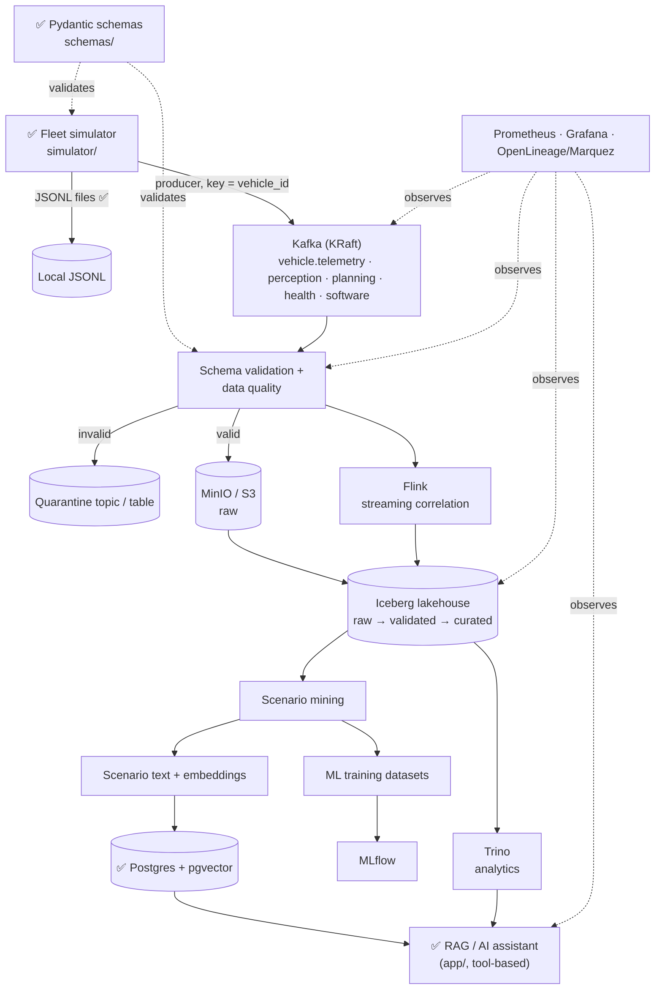

# Architecture

Target architecture for the Autonomous Systems Data & AI Platform. ✅ marks what
exists today; everything else is planned (see [`docs/plan.md`](../docs/plan.md)).



Plain-text version:

```text
Fleet simulator ──► Kafka ──► Validation / DQ ──┬──► Quarantine
     (✅)                                        ├──► MinIO raw ──► Iceberg ──► Trino ──┐
                                                 └──► Flink ──────────┘                 │
                                                        Iceberg ──► Scenario mining ──┬─► ML datasets ──► MLflow
                                                                                      └─► Embeddings ──► pgvector (✅) ──► RAG (✅)
```

## Components

| Layer | Component | Status | Notes |
|---|---|---|---|
| Data model | `schemas/` Pydantic models | ✅ | Single source of truth; see [data-model.md](data-model.md) |
| Generation | `simulator/` | ✅ | State-machine vehicles, 9 scenarios, planted failure chain, JSONL output |
| Ingestion | Kafka (single-node KRaft) | ✅ broker, topics, producer; MinIO lander pending | See [ingestion/README.md](../ingestion/README.md) |
| Data contracts | Schema Registry, validator, quarantine | ✅ (Iceberg quarantine table: Phase 5) | See [validation/README.md](../validation/README.md) |
| Storage | MinIO + Iceberg (REST catalog) | Phase 5 | `raw` / `validated` / `curated` namespaces |
| Analytics | Trino | Phase 6 | |
| Streaming | PyFlink | Phase 9 | Batch scenario mining first |
| ML | Scenario mining, datasets, MLflow | Phases 7–8, 10 | |
| AI | pgvector + RAG with tool use | ✅ base exists in `app/` | Moves to `rag/` in Milestone 4 |
| Ops | Prometheus, Grafana, OpenLineage | Phase 12 | |

## Key decisions so far

- **Partition key: `vehicle_id`** everywhere (Kafka partitions, Iceberg buckets).
  This preserves per-vehicle ordering and makes per-vehicle temporal joins local.
- **Event time, not ingest time.** Every event carries a UTC `timestamp`.
  Late and out-of-order events are expected and handled downstream.
- **Idempotency through `event_id`.** Replaying Kafka must not duplicate rows.
- **One local environment.** Platform services run as Compose profiles (`m1`, `m3`, …),
  so the production RAG deploy (`docker compose up` with no profile) is unaffected.
- **pgvector instead of OpenSearch** for vectors. It is already in the repo and
  uses about 2 GB less RAM.
